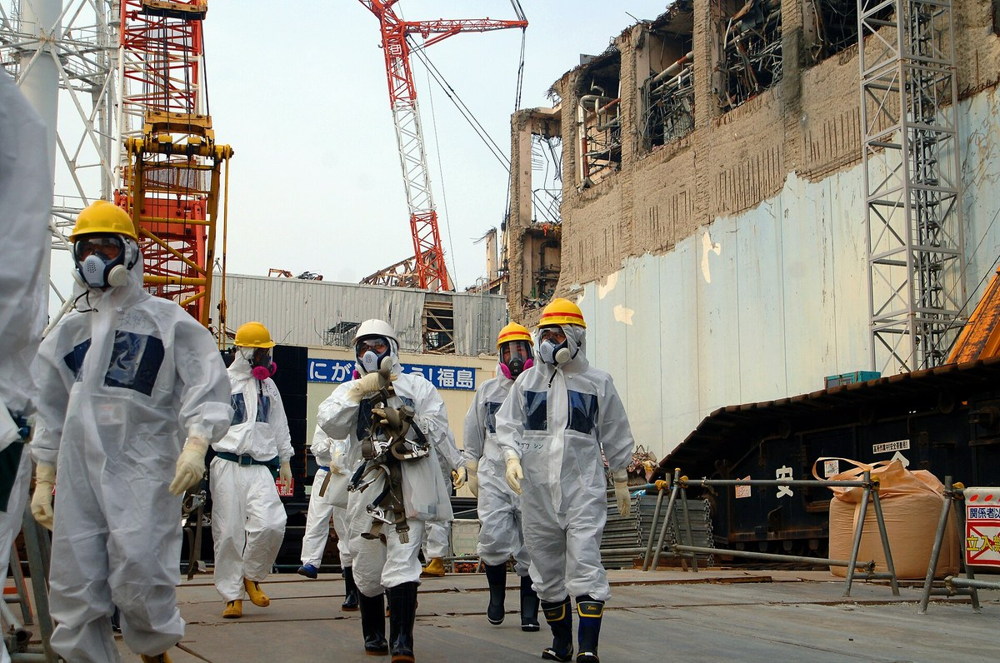
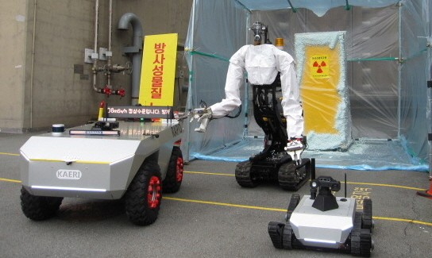
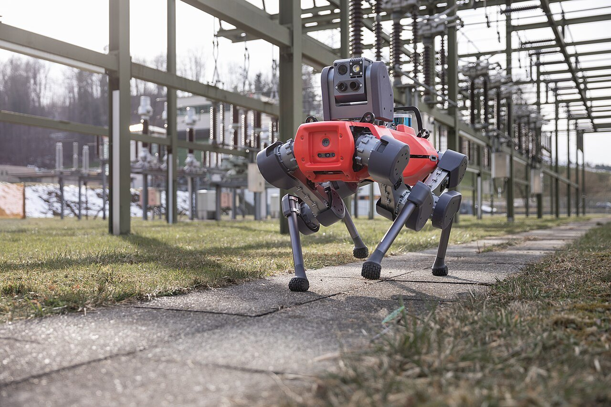

서상령 · 한국원자력연구원(KAERI) 로봇응용연구실

## 왜 로봇이 필요한가

원자력 시설에는 방사선 때문에 사람이 들어가기 어렵거나 오래 머물 수 없는 곳이 많다. 로봇응용연구실은 이런 곳에서 **사람 대신 일하는 로봇**을 연구한다. 목적은 크게 두 가지다.

- **사고 대응**: 후쿠시마 원전 사고처럼 사고가 나면 방사선량이 높고 구조물이 무너져 사람이 들어갈 수 없다. 이런 현장에 사람 대신 들어가 상황을 살피고 설비를 조작한다.
- **상시 점검**: 발전소와 플랜트 설비는 오래 쓸수록 정기 점검이 꼭 필요하다. 하지만 높거나 좁은 곳, 보온재로 덮인 배관처럼 사람이 점검하기엔 비용과 위험이 큰 곳이 많다. 이런 점검을 사람 대신 주기적으로 한다.

<figure><figcaption>후쿠시마 제1원전 4호기 (2013) Greg Webb / IAEA, <a href="https://commons.wikimedia.org/wiki/File:IAEA_Experts_at_Fukushima_(02813336).jpg">Wikimedia Commons</a>, CC BY-SA 2.0</figcaption></figure>
<figure><figcaption>KAERI 로봇응용연구실의 사고 대응 로봇들</figcaption></figure>
<figure><figcaption>변전소를 순찰하며 점검하는 4족 보행 로봇 Cvoellmy, <a href="https://commons.wikimedia.org/wiki/File:Anymal-robot-inspection-power-grid.jpg">Wikimedia Commons</a>, CC BY-SA 4.0</figcaption></figure>

## 연구 기록

- [FR3 로봇팔](fr3/index.html) · {{period:fr3}}
- [Teraffe 고소작업로봇](teraffe/index.html) · {{period:teraffe}}
- [PipeRobot 배관 로봇](piperobot/index.html) · {{period:piperobot}}
- [Kanake 뱀로봇](kanake/index.html) · {{period:kanake}}
- [R-BIZ 챌린지 우주 탐사 로버](rbiz/index.html) · {{period:rbiz}}
- [기타 프로젝트](other/index.html) · {{period:other}}
