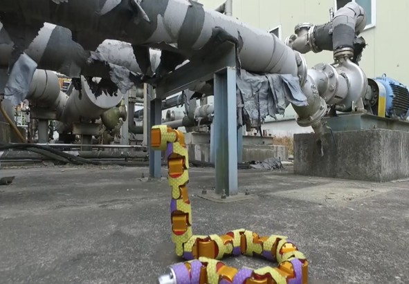
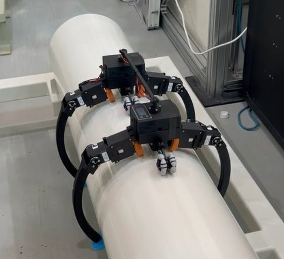

서상령 · 한국원자력연구원(KAERI) 로봇응용연구실

원자력 시설에는 방사선 때문에 사람이 들어가기 어렵거나 오래 머물 수 없는 곳이 많다. 이런 곳에서 **사람 대신 일하는 로봇**을 연구하고 있다. 목적에 따라 크게 두 갈래다.

## 사고 대응: 사람 대신 투입하는 로봇

후쿠시마 원전 사고처럼 사고가 나면 방사선량이 높고 구조물이 무너져 사람이 들어갈 수 없다. 이런 현장에 먼저 들어가 좁은 공간을 지나가고, 높은 곳의 설비를 직접 조작하는 로봇이다. 연구실에서는 원격 조작 로봇, 이동 로봇 등 여러 사고 대응 로봇을 개발해 왔다.

<figure><figcaption>방호복을 입고 후쿠시마 제1원전 4호기를 나서는 IAEA 조사단 (2013.04) 사진: Greg Webb / IAEA, <a href="https://commons.wikimedia.org/wiki/File:IAEA_Experts_at_Fukushima_(02813336).jpg">Wikimedia Commons</a>, CC BY-SA 2.0</figcaption></figure>
<figure><figcaption>연구실의 사고 대응 로봇들 (KAERI)</figcaption></figure>

<figure><figcaption>Teraffe: 높은 곳의 밸브 조작</figcaption></figure>
<figure><figcaption>Kanake: 좁은 틈을 지나가는 뱀로봇</figcaption></figure>

- **[Teraffe 고소작업로봇](teraffe/index.html)** · {{period:teraffe}} 
  다리 네 개의 길이를 따로 바꿔 3.5 m 높이까지 올라가 밸브를 조작하는 4륜 이동 로봇. 시뮬레이션 제어, 실물 리프트 제어, 강화학습 주행.
- **[Kanake 뱀로봇](kanake/index.html)** · {{period:kanake}} 
  좁은 틈과 장애물 사이를 지나가는 16관절 뱀로봇 KAERI-SNAKE IV를 강화학습으로 제어한 석사 학위논문 연구.

## 상시 점검: 사람 대신 순찰하는 로봇

발전소와 플랜트 설비는 오래 쓸수록 정기 점검이 꼭 필요하다. 하지만 점검 대상이 높거나 좁은 곳, 보온재로 덮인 배관에 있어 사람이 하기엔 비용과 위험이 크다. 4족 보행 로봇이 변전소나 해양 플랜트를 정해진 경로로 돌며 점검하는 것처럼, 이런 점검을 사람 대신 주기적으로 하는 로봇이다.

<figure><figcaption>변전소를 순찰하며 점검하는 4족 보행 로봇 ANYmal 사진: Cvoellmy, <a href="https://commons.wikimedia.org/wiki/File:Anymal-robot-inspection-power-grid.jpg">Wikimedia Commons</a>, CC BY-SA 4.0</figcaption></figure>
<figure><figcaption>PipeRobot: 보온재 배관을 따라 달리는 검사 로봇</figcaption></figure>

- **[PipeRobot 배관 로봇](piperobot/index.html)** · {{period:piperobot}} 
  보온재 배관의 바깥 면을 따라 직선과 곡관을 달리며 검사장비를 실어 나르는 경량 로봇.

## 로봇팔 작업 학습

두 갈래 모두 결국 로봇팔로 작업을 해야 한다. 사람이 매번 조종하지 않아도 로봇이 작업을 배우도록 모방학습을 익히고 있다.

- **[FR3 로봇팔](fr3/index.html)** · {{period:fr3}} 
  Franka Research 3로 큐브 집어 옮기기를 만들고, 자동 수집한 시연으로 BC·ACT 모방학습 연습.
